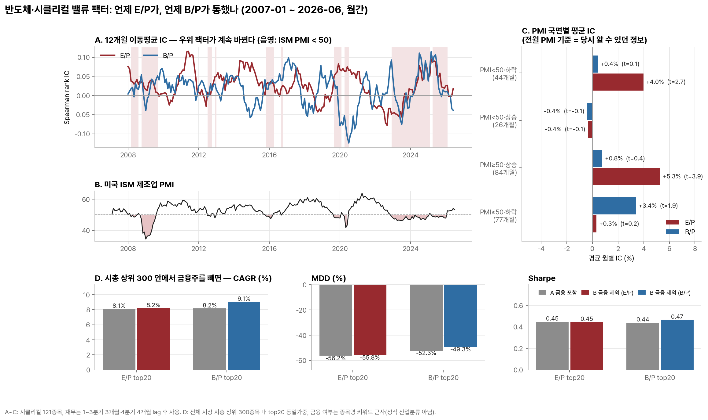
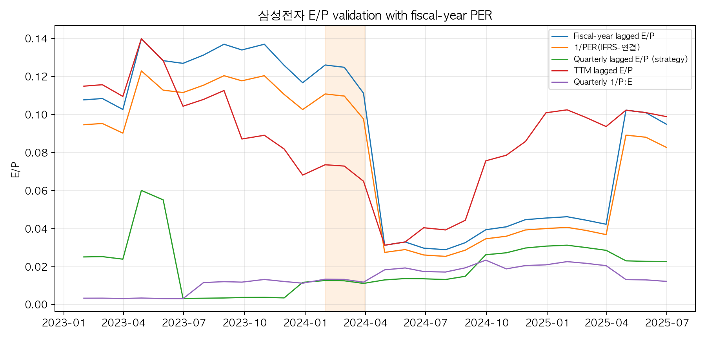
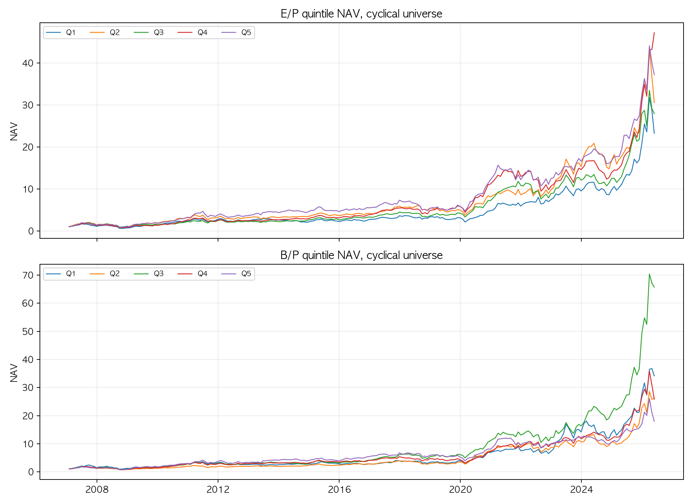
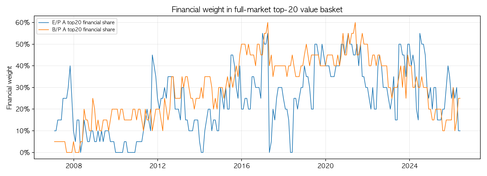
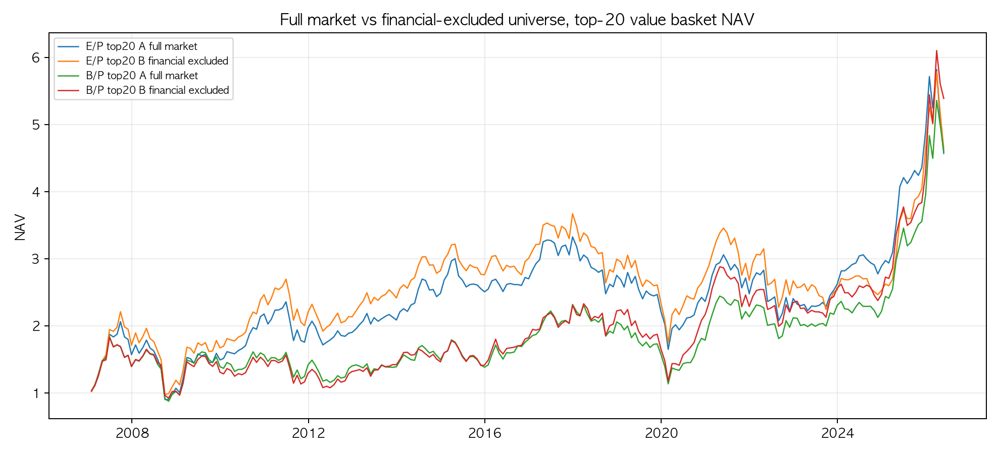
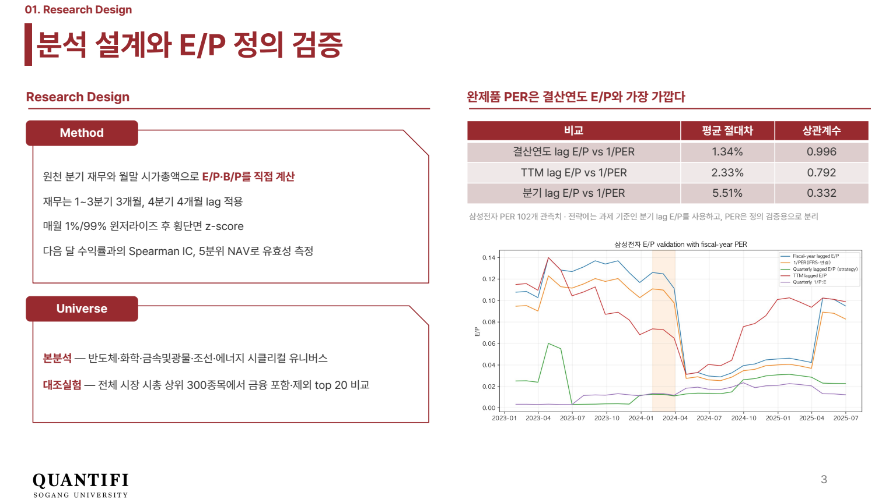
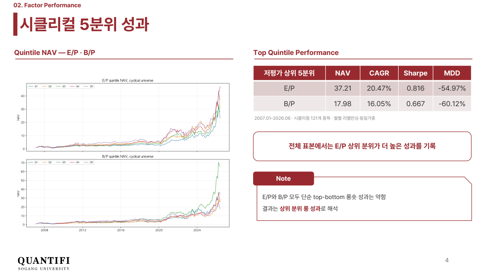
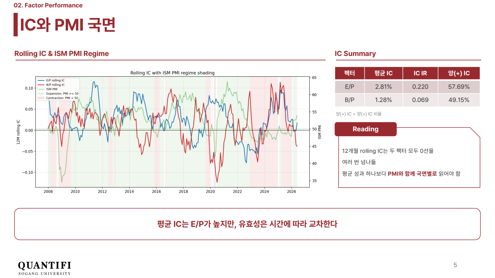
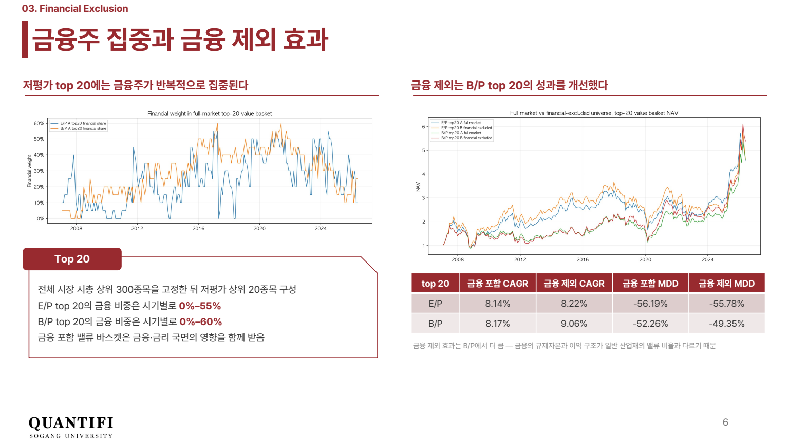

# 반도체·시클리컬 밸류 팩터는 언제 통하나 — E/P·B/P 원천 재현과 PMI 국면 검증 (2026 여름 · QUANTIFI 개인 과제)

> DataGuide 완제품 PER·PBR을 쓰지 않고 분기 재무 원천값과 공시 시차로 E/P·B/P를 직접 만든 뒤, 2007~2026년 시클리컬 121종목에서 두 팩터의 유효성이 경기 국면에 따라 어떻게 갈리는지, 그리고 전체 시장 밸류 바스켓에서 금융주를 빼면 무엇이 달라지는지 검증했습니다.

[발표자료 PDF 보기](docs/반도체_밸류팩터_국면검증_발표.pdf) · [분석 결과 보고서](output/results/반도체_밸류팩터_국면검증_분석결과.md) · [재현 노트북](notebooks/value_factor_regime.ipynb) · [전체 재현 코드](src/value_factor_regime.py)

## 연구 질문

1. 원천 재무로 직접 만든 E/P는 DataGuide PER과 같은 정의인가? (정의가 틀리면 이후 결론이 모두 무의미)
2. 반도체·시클리컬에서 E/P와 B/P 중 무엇이 다음 달 수익률을 더 잘 설명하고, 그 우위는 **ISM PMI 국면에 따라 바뀌는가?**
3. 저PER·저PBR 바스켓에 금융주가 얼마나 끼어들고, 금융주를 빼면 성과가 달라지는가?

## 대표 차트

[](output/charts/hero_ic_pmi_financial.png)

- **A·B:** 12개월 이동평균 IC가 두 팩터 모두 0선을 여러 번 넘나듭니다. 전체 평균은 E/P 2.81%, B/P 1.28%로 E/P가 높지만, 2016~2017년과 2024~2025년에는 B/P가 더 강했습니다.
- **C:** 그 시점에 실제로 알 수 있던 **전월** PMI로 국면을 나누면, E/P는 PMI≥50·상승 국면(IC 5.3%, t=3.9)과 PMI<50·하락 국면(4.0%, t=2.7)에서 유의했고, B/P는 어느 국면에서도 t=2를 넘지 못했습니다.
- **D:** 시총 상위 300종목 안에서 금융주를 빼면 B/P top20의 CAGR이 8.17%→9.06%, MDD가 -52.3%→-49.3%로 개선됐지만 E/P top20은 거의 변하지 않았습니다.

## 한눈에 보기

| 항목 | 내용 |
| --- | --- |
| 기간·유니버스 | 성과·IC 2007-01 ~ 2026-06 (233개월). 본분석은 시클리컬(반도체·화학·금속및광물·조선·에너지) 121종목, 금융 대조실험은 전체 시장 시총 상위 300종목 |
| 팩터 정의 | E/P = 지배주주 분기순이익 / 시가총액, B/P = 지배주주 자본 / 시가총액. 매월 1%/99% 윈저라이즈 후 단면 z-score |
| 데이터 이용 가능 시점 | **재무:** 1~3분기는 분기말 후 3개월, 4분기(사업보고서)는 4개월 뒤부터 사용 가능하다고 보고 월말에 as-of 매칭. **시가총액:** 리밸런싱 월말 값. **수익률:** 월말 t 신호 → t+1월 수익률. **PMI:** 다음 달 첫 영업일 발표이므로 국면 판정에는 전월 값을 사용(동월 값 결과는 사후 해석용으로 따로 표시) |
| 본인 역할 | 개인 과제. 데이터 수집, E/P 정의 검증, 팩터·IC·분위 포트폴리오 코드, 금융 대조실험, 발표자료 작성 모두 본인 |
| 핵심 결과 | E/P 상위 분위 CAGR 20.5%, Sharpe 0.82 vs B/P 상위 분위 16.0%, 0.67. 평균 IC E/P 2.81%(IR 0.22), B/P 1.28%(IR 0.07) |
| 잘 안 된 결과 | 두 팩터 모두 상위-하위 롱숏은 수익이 없었음(E/P -0.06%, B/P -7.6% CAGR). PMI 국면 해석은 PMI 발표 시차를 반영하면 결론이 바뀜 |

## 잘 안 된 결과와 그 해석

### 1. 팩터 "스프레드"는 없었다

| 포트폴리오 (시클리컬, 동일가중) | CAGR | 연변동성 | Sharpe | MDD |
| --- | ---: | ---: | ---: | ---: |
| E/P 상위 20% | 20.47% | 27.61% | 0.82 | -54.97% |
| B/P 상위 20% | 16.05% | 28.42% | 0.67 | -60.12% |
| E/P 상위-하위 롱숏 | -0.06% | 16.99% | 0.08 | -55.96% |
| B/P 상위-하위 롱숏 | -7.57% | 25.04% | -0.18 | -86.89% |

상위 분위의 절대 성과는 좋았지만 하위 분위도 함께 올랐습니다. 2007~2026년 시클리컬 업종 자체의 상승과 생존 종목 위주 유니버스(아래 한계 참고)가 상위 분위 성과를 끌어올렸을 가능성이 있어, 결과는 "싼 종목이 비싼 종목을 이겼다"가 아니라 "상위 분위 롱 성과"로만 해석했습니다.

### 2. PMI 국면 해석은 발표 시차에 민감했다

`output/tables/ic_by_pmi_regime.csv`

| 국면 | 동월 PMI 기준 (사후 해석) E/P · B/P | 전월 PMI 기준 (당시 관측 가능) E/P · B/P |
| --- | --- | --- |
| PMI<50·하락 | 3.6% · -3.3% | **4.0% (t=2.7)** · 0.4% |
| PMI<50·상승 | 1.6% · **6.4% (t=1.6)** | -0.4% · -0.4% |
| PMI≥50·상승 | 1.8% · 0.1% | **5.3% (t=3.9)** · 0.8% |
| PMI≥50·하락 | **3.9% (t=2.7)** · **3.9% (t=2.1)** | 0.3% · 3.4% (t=1.9) |

같은 달 PMI로 보면 "경기 바닥에서 회복할 때 B/P가 강하다"는 리포트식 이야기가 보입니다. 하지만 PMI는 다음 달 초에 발표되므로, 그 달 초에 알 수 있던 전월 PMI로 다시 나누면 그 패턴이 사라집니다. PMI<50·상승 국면은 26개월뿐이라 표본도 작습니다. 따라서 **PMI로 E/P·B/P를 전환하는 규칙은 이 데이터로 뒷받침되지 않는다**고 결론냈고, rolling IC는 국면 판단 도구가 아니라 "평균 IC 하나로 팩터를 고르면 안 된다"는 근거로만 사용했습니다.

### 3. 금융주 분류는 근사치다

정식 DataGuide 금융 산업군 파일이 없어 종목명 키워드(금융·은행·증권·보험·생명·화재·카드·캐피탈 등)로 441개 종목을 금융으로 분류했습니다. 전체 시장 E/P top20의 금융 비중은 월평균 24.6%(최대 55%), B/P top20은 29.6%(최대 60%)였습니다. 키워드에 걸리지 않는 지주사나 이름에 "생명"이 들어간 비금융 종목이 섞일 수 있으므로, D 패널의 금융 제외 효과는 방향성만 참고하고 정식 산업분류로 재검증해야 합니다. 코드는 `input/processed_data/금융유니버스.csv`가 있으면 자동으로 그 파일을 우선 사용합니다.

## E/P 정의 검증

[](output/charts/ep_validation_per.png)

| 비교 | 중앙 절대차 | 상관계수 | 관측치 |
| --- | ---: | ---: | ---: |
| 결산연도 lag E/P vs 1/PER(IFRS-연결) | 1.23% | 0.996 | 102 |
| TTM lag E/P vs 1/PER | 1.97% | 0.792 | 102 |
| 분기 lag E/P (전략용) vs 1/PER | 5.46% | 0.332 | 102 |

DataGuide PER은 결산연도 기준 지표여서 결산연도로 합산한 E/P와 상관 0.996으로 일치했습니다. 전략에는 과제 기준인 분기 lag E/P를 사용했고, 같은 유니버스에서 분기·TTM·결산연도 E/P를 모두 비교해 분기 E/P의 IC가 가장 높다는 것도 확인했습니다(2.81% vs 2.45% vs 2.11%). 다만 PER 검증 데이터는 삼성전자 1종목 102개월뿐입니다.

## 결과 차트

<table>
  <tr>
    <td width="50%" valign="top"><strong>E/P·B/P 5분위 NAV (시클리컬)</strong><br><a href="output/charts/quintile_nav_ep_bp.png"></a></td>
    <td width="50%" valign="top"><strong>전체 시장 top20의 금융 비중</strong><br><a href="output/charts/full_market_financial_share_top20.png"></a></td>
  </tr>
  <tr>
    <td colspan="2" align="center"><strong>금융 포함(A) vs 제외(B) top20 NAV</strong><br><a href="output/charts/full_vs_ex_financial_nav.png"></a></td>
  </tr>
</table>

## 발표자료

이미지를 클릭하면 PDF 원본이 열립니다.

<table>
  <tr>
    <td width="50%"><a href="docs/반도체_밸류팩터_국면검증_발표.pdf"></a></td>
    <td width="50%"><a href="docs/반도체_밸류팩터_국면검증_발표.pdf"></a></td>
  </tr>
  <tr>
    <td width="50%"><a href="docs/반도체_밸류팩터_국면검증_발표.pdf"></a></td>
    <td width="50%"><a href="docs/반도체_밸류팩터_국면검증_발표.pdf"></a></td>
  </tr>
</table>

## 방법

```math
EP_{i,t} = \frac{NI^{\mathrm{avail}}_{i,t}}{MCAP_{i,t}}, \qquad
BP_{i,t} = \frac{EQ^{\mathrm{avail}}_{i,t}}{MCAP_{i,t}}, \qquad
X^{\mathrm{avail}}_{i,t} = X_{i,q^*(t)},\ \ q^*(t) = \max\{q : \mathrm{end}(q) + \ell_q \le t\},\ \ \ell_q = \begin{cases} 3\text{개월} & Q1\sim Q3 \\ 4\text{개월} & Q4 \end{cases}
```

```math
IC_t = \mathrm{corr}_{\mathrm{Spearman}}\left(z_{i,t},\ r_{i,t\to t+1}\right)
```

- 재무 원천값은 천원, 시가총액은 백만원 단위여서 분모에 `시가총액 × 1000`을 사용했습니다. 이 단위 확인을 빠뜨리면 E/P가 1,000배로 커집니다.
- 금융 대조실험은 매월 전체 시장 시총 상위 300종목을 먼저 고정하고, B에서만 금융 종목을 뺀 뒤 top20을 뽑습니다. B에서 시총 상위 300을 다시 뽑으면 두 유니버스의 크기 효과가 섞이기 때문입니다.
- 제조업 유니버스 결과(E/P 8.98%, B/P 9.25% CAGR)는 금융 외 비제조업까지 빠지므로 금융 제외 효과와 구분해 참고용으로만 두었습니다.

## 폴더 구성

| 경로 | 내용 |
| --- | --- |
| `src/value_factor_regime.py` | 원천 데이터 → lag 재무 → E/P·B/P → IC·5분위·금융 대조실험 → 결과표·차트·보고서 생성 |
| `src/build_portfolio_charts.py` | 대표 차트와 PMI 국면별 IC 표 (`output/tables/ic_by_pmi_regime.csv`) |
| `notebooks/value_factor_regime.ipynb` | 과제 제출용 실행 노트북 |
| `output/results/` | 과제 제출 시점의 결과표, 차트, 분석 결과 보고서 |
| `output/tables/`, `output/charts/` | README용 시계열·국면 표와 차트 |
| `docs/` | 발표자료 PDF·PPTX |
| `sample_data/`, `scripts/generate_sample_data.py` | 입력 열 구조만 보여주는 합성 데이터 |

## 재실행

```bash
pip install -r requirements.txt
python src/value_factor_regime.py      # input/processed_data/ 원본 필요
python src/build_portfolio_charts.py
```

원본은 FnGuide DataGuide 데이터라 공개하지 않습니다. 저장소에는 코드, 합성 샘플, 파생 결과만 포함합니다.

## 한계

- **생존편향:** 시클리컬 유니버스 121종목은 모두 2026년 6월에도 상장된 현재 목록입니다. 과거에 상장폐지된 시클리컬 종목이 빠져 있어 상위 분위 성과가 과대평가됐을 수 있습니다. (전체 시장 대조실험의 가격 데이터에는 상장폐지 종목 1,350개가 포함돼 있습니다.)
- 공시 시차는 법정 제출기한 기준의 일괄 가정이며, 실제 공시일 데이터로 맞추지 않았습니다.
- 금융 분류는 종목명 키워드 근사입니다.
- PER 검증은 삼성전자 1종목입니다.
- 거래비용 미반영, 연구·교육 목적의 백테스트입니다.
