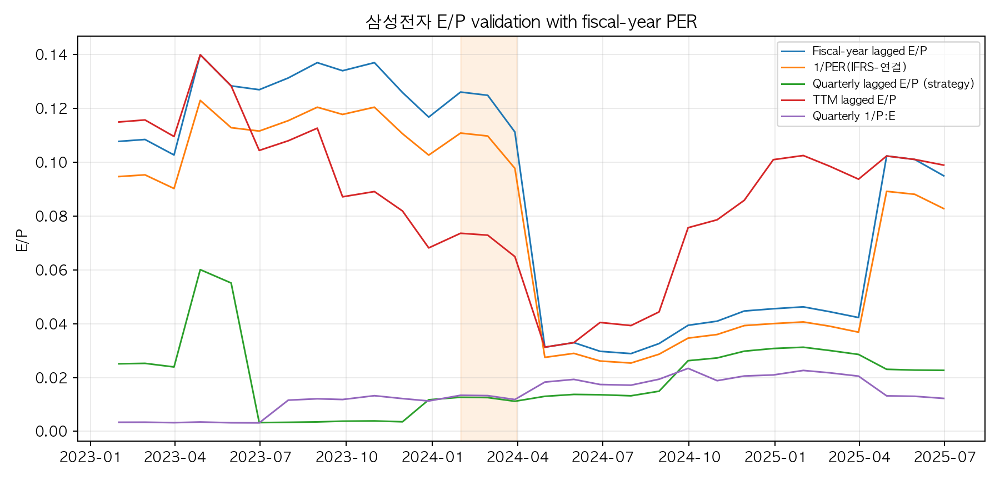
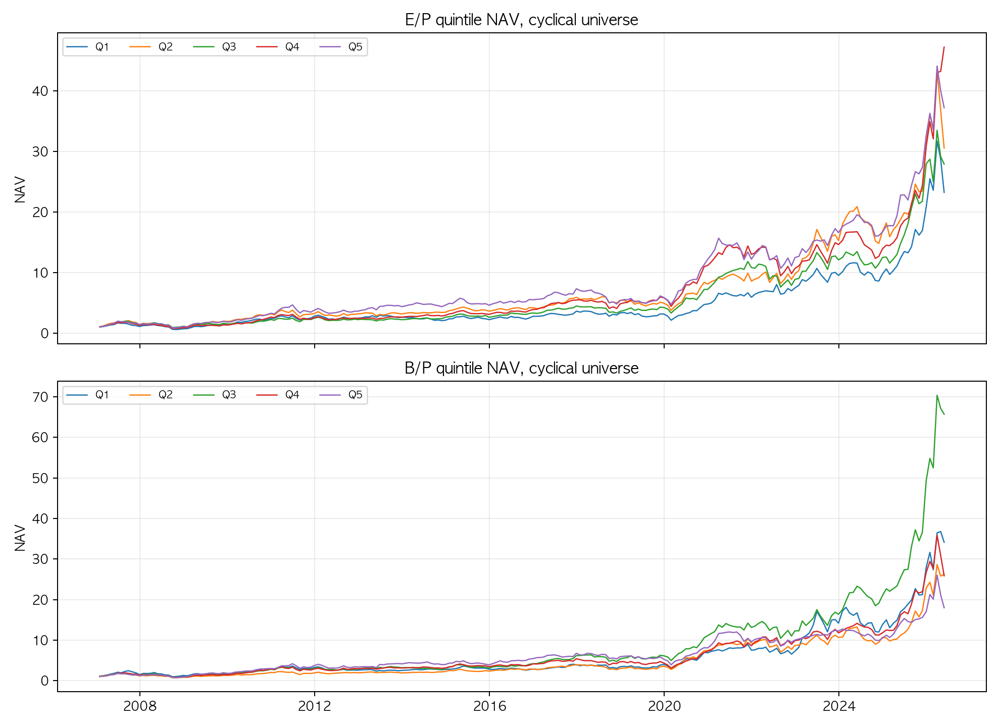
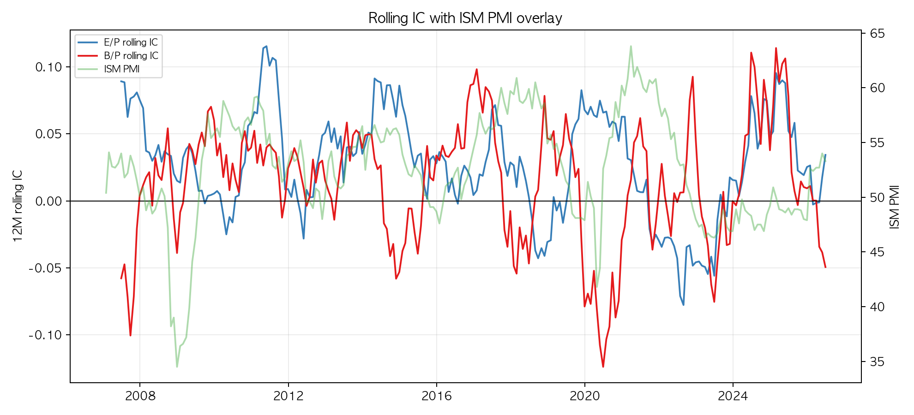
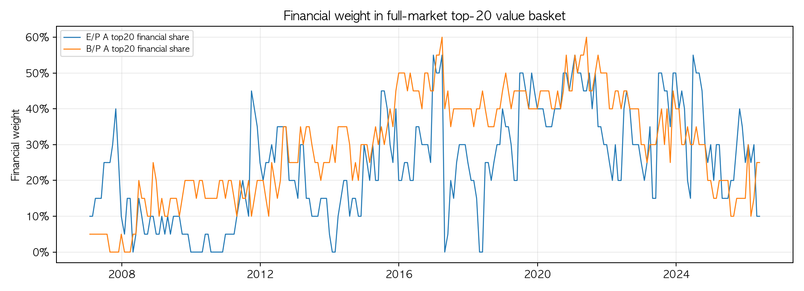
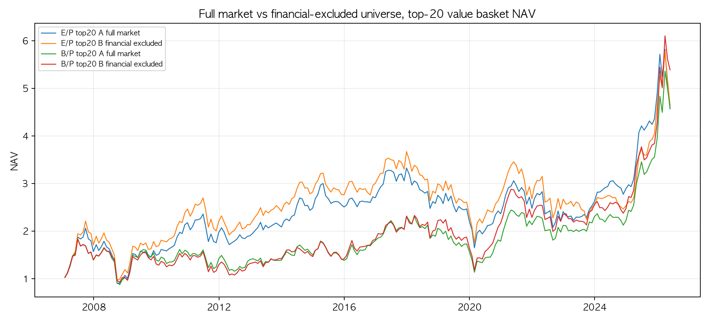

# 반도체 밸류 팩터 국면 검증 결과

## 1. 사용 파일과 처리 범위

- 과제 지시문: QUANTIFI 4주차 과제 명세 (비공개)
- 원본 Excel: `input/raw_data/4주차 데이터 원본.xlsx`
- 사용 CSV 폴더: `input/processed_data`
- 가격·시총·재무 공통 기간: 2006-01-31 ~ 2026-06-30
- 성과·IC 계산 기간: 2007-01-31 ~ 2026-06-30
- 전체 종목 수: 3,980개
- 시클리컬 유니버스 교집합: 121개
- 시클리컬 유니버스 중 가격·재무 데이터에 없는 종목 수: 0개
- 제조업 유니버스 교집합: 3,527개
- 제조업 유니버스 중 가격·재무 데이터에 없는 종목 수: 1개
- 금융 분류: 종목명 금융 키워드 fallback 사용, 금융 플래그 441개
- PER 검증 데이터: `PER(IFRS-연결).csv` 사용, PER 관측치 102개, PER 보유 종목 1개
- PER 검증 기간: 2018-01-31 ~ 2026-06-30

## 2. 방법론 요약

원천 데이터에서 직접 `E/P = 이익 / 시가총액`, `B/P = 지배주주자본 / 시가총액`을 계산했습니다. 재무 데이터 단위가 시가총액보다 1,000배 크게 잡혀 있어 `시가총액 * 1000`을 분모로 사용했습니다. 분기 재무값은 룩어헤드를 막기 위해 1~3분기는 분기말 후 3개월, 4분기는 분기말 후 4개월 뒤부터 사용 가능하다고 보고 월말 데이터에 as-of 방식으로 매칭했습니다.

IC·성과·포트폴리오 구성에 쓰는 전략용 E/P는 원천 분기 데이터를 lag 적용한 `분기 지배주주순이익 / 시가총액`입니다. `TTM E/P`와 `결산연도 E/P`도 따로 계산하지만, 이 둘은 PER 검증 및 정의 비교용으로만 남겼습니다. 분기 E/P는 계절성·노이즈가 크고 이익 모멘텀 성격이 섞일 수 있으나, 새 과제 Markdown의 실측 기준에 맞춰 전략 팩터로 채택했습니다.

전략용 E/P 정의 선택을 확인하기 위해 같은 시클리컬 유니버스에서 분기·TTM·결산연도 E/P를 모두 비교했습니다.

| E/P Definition                  | Mean IC   | IC Std   |   IC IR | Positive IC Ratio   | Q5 CAGR   |   Q5 Sharpe | Q5 MDD   |   Q5 Months |
|:--------------------------------|:----------|:---------|--------:|:--------------------|:----------|------------:|:---------|------------:|
| Quarterly lagged E/P (strategy) | 2.81%     | 12.77%   |   0.22  | 57.69%              | 20.47%    |       0.816 | -54.97%  |         233 |
| TTM lagged E/P                  | 2.45%     | 14.22%   |   0.172 | 58.12%              | 15.54%    |       0.683 | -63.62%  |         230 |
| Fiscal-year lagged E/P          | 2.11%     | 15.02%   |   0.141 | 52.99%              | 15.72%    |       0.663 | -65.12%  |         230 |

팩터는 매월 횡단면 1%/99% 윈저라이즈 후 z-score로 표준화했고, 다음 달 수정주가 수익률과의 스피어만 rank IC 및 5분위 동일가중 포트폴리오 성과를 계산했습니다. 본분석은 `시클리컬 유니버스.csv` 기준입니다.

금융 포함/제외 대조 실험은 새 과제 Markdown에 맞춰 A=전체 시장, B=금융 제외 유니버스로 계산하도록 바꿨습니다. 둘 다 전체 시총 상위 300종목 base를 먼저 고정한 뒤, B에서만 금융 플래그 종목을 제외합니다. 다만 현재 4주차 폴더에는 DataGuide 금융 산업군 매핑 파일이 없어, 실행 가능한 fallback으로 종목명 금융 키워드 플래그를 사용했습니다. 제조업 유니버스는 금융 외 비제조업까지 제외하므로 참고 실험으로만 별도 표시했습니다.

## 3. PER 결산 기준 검증

새로 추가된 `PER(IFRS-연결).csv`를 반영했습니다. 이 파일은 현재 삼성전자 중심으로 들어 있어, PER 검증은 PER가 존재하는 종목·기간에 한정했습니다. `PER(IFRS-연결)`은 TTM이 아니라 결산 PER로 보이므로, 검증용으로만 `직전 결산연도 4개 분기 합산 이익 / 월말 시가총액`을 따로 만들고 Q4 결산값은 4개월 lag 후 사용했습니다. 전략용 분기 E/P와 TTM E/P는 아래 표에 같이 표시하되, `1/PER`와 완전히 일치해야 하는 검증 대상은 결산연도 E/P입니다. `P:E.csv`는 기존처럼 발표 lag가 없는 분기형 P/E 항목으로 별도 비교 행에 남겼습니다.

| Check                                      | Median Abs Diff   | Mean Abs Diff   |   Correlation |   Coverage Obs |
|:-------------------------------------------|:------------------|:----------------|--------------:|---------------:|
| Fiscal-year lagged E/P vs 1/PER(IFRS-연결) | 1.23%             | 1.34%           |         0.996 |            102 |
| TTM lagged E/P vs 1/PER(IFRS-연결)         | 1.97%             | 2.33%           |         0.792 |            102 |
| Quarterly lagged E/P vs 1/PER(IFRS-연결)   | 5.46%             | 5.51%           |         0.332 |            102 |
| Quarterly unlagged E/P vs 1/P:E            | 0.00%             | 0.43%           |         0.745 |          84116 |
| Quarterly lagged E/P vs 1/P:E              | 1.75%             | 5.77%           |         0.015 |          83626 |
| 1/P:E vs 1/PER(IFRS-연결)                  | 4.65%             | 5.96%           |        -0.115 |             99 |

삼성전자 기준으로 `1/PER`는 분기 E/P보다 결산연도 E/P와 훨씬 잘 맞습니다. 따라서 `PER(IFRS-연결)`은 결산 기준 sanity check로만 쓰고, IC·성과 분석은 원천 데이터로 직접 만든 분기 E/P를 사용했습니다. 완전히 일치하지 않는 잔차는 DataGuide PER가 순이익 총액이 아니라 EPS와 주식수 조정 등을 거친 완제품 지표이기 때문으로 봐야 합니다.

## 4. 시클리컬 유니버스 성과

| Portfolio                 |   개월수 |    NAV | CAGR   | Ann.Vol   |   Sharpe | MDD     |
|:--------------------------|---------:|-------:|:-------|:----------|---------:|:--------|
| Cyclical E/P top quintile |      233 | 37.213 | 20.47% | 27.61%    |    0.816 | -54.97% |
| Cyclical B/P top quintile |      233 | 17.982 | 16.05% | 28.42%    |    0.667 | -60.12% |
| Cyclical E/P top-bottom   |      233 |  0.988 | -0.06% | 16.99%    |    0.082 | -55.96% |
| Cyclical B/P top-bottom   |      233 |  0.217 | -7.57% | 25.04%    |   -0.184 | -86.89% |

## 5. IC와 국면 해석

| Factor   | Mean IC   | IC Std   |   IC IR | Positive IC Ratio   |
|:---------|:----------|:---------|--------:|:--------------------|
| E/P      | 2.81%     | 12.77%   |   0.22  | 57.69%              |
| B/P      | 1.28%     | 18.48%   |   0.069 | 49.15%              |

12개월 rolling IC 기준으로 B/P가 가장 강했던 시점은 2025-02, 2024-06, 2025-05입니다. 반대로 E/P rolling IC가 가장 약했던 시점은 2022-08, 2022-07, 2023-06입니다.

해석상 B/P는 순자산 대비 가격이 낮은 시클리컬 자산주를 포착하는 성격이 강하고, E/P는 발표 가능한 단일 분기 이익이 가격을 설명하는지를 봅니다. 이번 처리 데이터에서는 평균 IC와 상위 분위 NAV 모두 E/P가 B/P보다 높게 나왔습니다. 다만 분기 E/P는 이익 모멘텀 성격과 계절성 노이즈가 섞일 수 있으므로, 결론은 “한 팩터가 항상 우위”라기보다 rolling IC와 PMI를 같이 보면서 유효 국면을 나눠 해석하는 쪽이 더 맞습니다.

## 6. 금융 포함/제외 대조 실험

대조 실험은 매월 전체 시장의 시가총액 상위 300종목을 먼저 고정한 뒤, A는 그 안에서 바로 팩터 상위 20종목을 뽑고 B는 같은 top300 base에서 금융 플래그 종목만 제외한 뒤 팩터 상위 20종목을 뽑았습니다. 즉 B에서 다시 시총 상위 300종목을 뽑지 않습니다. 전체 시장 A 바스켓의 금융 플래그 비중도 함께 표시했습니다.

| Portfolio                      |   개월수 |   NAV | CAGR   | Ann.Vol   |   Sharpe | MDD     |
|:-------------------------------|---------:|------:|:-------|:----------|---------:|:--------|
| E/P top20 A full market        |      233 | 4.57  | 8.14%  | 24.00%    |    0.449 | -56.19% |
| E/P top20 B financial excluded |      233 | 4.639 | 8.22%  | 24.70%    |    0.446 | -55.78% |
| B/P top20 A full market        |      233 | 4.598 | 8.17%  | 24.95%    |    0.44  | -52.26% |
| B/P top20 B financial excluded |      233 | 5.389 | 9.06%  | 25.69%    |    0.467 | -49.35% |

대표 스냅샷은 `2026-05-29`의 전체 시장 B/P 상위 20종목입니다. 이 표에는 각 종목의 금융 플래그를 표시했습니다. 전체 시장 결과와 금융 제외 결과를 나란히 보면, 저PBR·저PER 바스켓에 금융주가 얼마나 끼어드는지 확인할 수 있습니다.

제조업 유니버스 근사는 새 과제 Markdown처럼 참고용으로만 남겼습니다. 제조업은 금융뿐 아니라 유통·서비스 등 비제조업 전체를 함께 제외하므로, 금융 제외 효과와 동일하게 해석하면 안 됩니다.

| Portfolio                     |   개월수 |   NAV | CAGR   | Ann.Vol   |   Sharpe | MDD     |
|:------------------------------|---------:|------:|:-------|:----------|---------:|:--------|
| E/P top20 manufacturing proxy |      233 | 5.313 | 8.98%  | 24.53%    |    0.476 | -52.97% |
| B/P top20 manufacturing proxy |      233 | 5.574 | 9.25%  | 25.64%    |    0.474 | -51.24% |

현재 수치는 정식 산업군 매핑이 아니라 종목명 fallback 기준입니다. 제출 전 `금융유니버스.csv` 또는 `금융업유니버스.csv`를 추가하면 코드가 자동으로 그 파일을 우선 사용합니다.

## 7. 제출 체크리스트

- Raw 데이터 Excel: 원본 파일 `input/raw_data/4주차 데이터 원본.xlsx` 그대로 제출
- 분석·검증 결과: 이 Markdown 파일 제출
- Code: `반도체_밸류팩터_국면검증_재현.ipynb` 제출

## 8. 남은 보완점

1. 현재 `PER(IFRS-연결).csv`는 삼성전자 중심으로만 들어 있어 전체 종목 검증은 제한적입니다. 결산 PER를 전체 종목으로 확장하면 검증 표본을 넓힐 수 있습니다.
2. 금융 분류는 `금융유니버스.csv` 같은 DataGuide 금융 산업군 파일이 있으면 자동으로 우선 사용합니다. 현재 파일이 없으면 종목명 fallback이므로, 정식 제출 전 금융 산업군 파일을 추가해 다시 실행하는 것이 가장 안전합니다.
3. PER와 원천 E/P의 완전 일치를 확인하려면 DataGuide PER 산식에 쓰인 결산 EPS 또는 보통주 조정 주식수 항목까지 같이 받아 확인하는 것이 가장 정확합니다.
